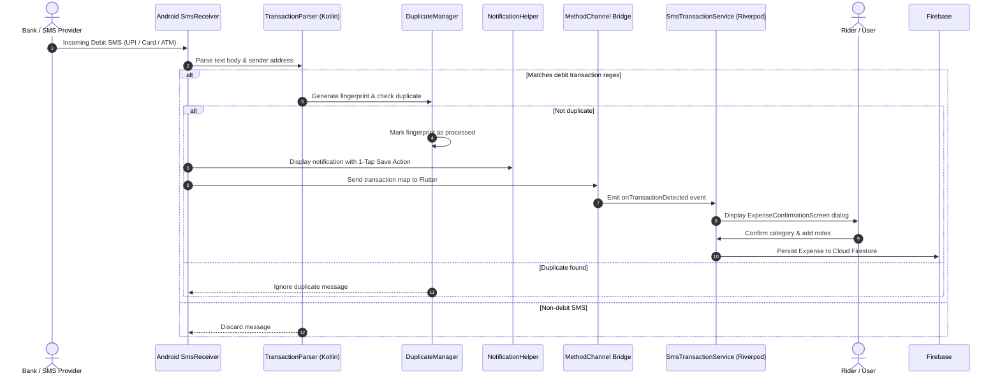

# MOTO LOGG 🏍️
### The Ultimate Motorcycle Expense, Fuel Economy & Smart SMS Detection Suite

[](https://flutter.dev)
[](https://dart.dev)
[](https://riverpod.dev)
[](https://firebase.google.com)
[](https://developer.android.com)
[](LICENSE)

**MOTO LOGG** is an industrial-themed, enthusiast-engineered Flutter application designed for motorcycle riders who want to track every penny spent on their machines. Combining a tactile dark aesthetic with automated Android bank SMS debit detection, real-world mileage calculations (km/L & ₹/km), interactive component-level expense mapping, and multi-bike virtual garage support.

---

## ✨ Features

### ⚡ Automated Bank SMS Expense Detection (Android Native)
- **Real-Time SMS Interception:** A native Android Kotlin `BroadcastReceiver` (`SmsReceiver.kt`) intercepts incoming bank and payment debit messages (UPI, Netbanking, Debit/Credit Card, ATM withdrawals).
- **Intelligent Transaction Parsing:** Regex-powered `TransactionParser` automatically extracts transaction amounts, merchant names, payment modes, reference IDs, and timestamps.
- **1-Tap Notification Quick Actions:** Interactive system notification with immediate "Save Expense" action via `ExpenseActionReceiver.kt`, logging the cost without switching apps.
- **Duplicate Shield:** Fingerprint and hash-based deduplication (`DuplicateManager.kt`) ensures no payment SMS is recorded twice.
- **Offline / Catch-Up Sync:** `SmsInboxScanner.kt` scans the device SMS inbox for transactions received while the app was closed or backgrounded.
- **Fine-Grained Permissions & Controls:** In-app permission manager (`SmsPermissionHelper`) and dedicated SMS settings sheet with lookback sync controls.

### 🎯 Interactive Motorcycle Blueprint & Visual Expense Mapping
- **Component Callout System:** Interactive motorcycle wireframe with custom vector painters (`CurvedArrowsPainter`, `FallbackBikePainter`, `FuelWavePainter`).
- **Direct Visual Mapping:** Callouts link expenses directly to physical bike areas:
  - ⛽ **Fuel Tank:** Refueling stops and petrol costs
  - 🔧 **Engine & Drivetrain:** Scheduled services, oil changes, tune-ups
  - ⚡ **Bodywork & Performance:** Aftermarket modifications, exhausts, ECU flashes
  - 🪖 **Rider & Bike Gear:** Helmets, luggage, crash guards, fog lights
- **Real-Time Aggregates:** Dynamic calculation of category sub-totals and grand totals.

### ⛽ Precise Mileage & Fuel Efficiency Calculator
- **Odometer Refill Logging:** Record fuel volume (Liters), price per liter, and odometer readings.
- **Real-World Metrics:** Computes actual fuel economy (**km/L**), trip distance between refuels, and running cost per kilometer (**₹/km**).
- **Refuel History:** Historical logs with previous-vs-current comparison cards.

### 📅 Calendar & Categorized Expense Ledger
- **Day-by-Day Calendar View:** Interactive expense calendar powered by `table_calendar`, showing daily spending indicators and transaction rollups.
- **Grouped Monthly Logs:** Clean chronological expense feed grouped by year and month.
- **Fast Expense Entry:** Modal sheet (`AddExpenseSheet`) with quick category chips, note inputs, merchant tag, and date selection.

### 🏍️ Multi-Bike Virtual Garage
- **Preset & Custom Motorcycles:** Switch between pre-loaded machines (Bajaj Pulsar NS200, Honda Unicorn 160, Yamaha MT-15) or configure your own.
- **Detailed Specs:** Tracks engine displacement (cc), horsepower (hp), brand name, custom image assets, and model taglines.
- **Hybrid Storage:** Quick local preference caching with full Firebase Cloud Firestore synchronization.

### 📊 Comprehensive Spending Reports & Analytics
- **Category Distribution:** Visual percentage share and expenditure bars.
- **Top Spend Highlighting:** Instant visibility into the highest expense category.
- **Flexible Filters:** Filter reports by custom timeframes, monthly periods, or all-time expenditure.

### 🎨 Industrial Cyberpunk UI/UX
- **Aesthetic:** High-contrast dark palette (`#0F0F11`, `#161618`), metallic card borders, and vibrant neon accents (Amber, Cyan, Emerald).
- **Micro-Interactions:** Smooth tactile animations using `flutter_animate`.
- **Custom Floating Navigation:** Floating curved bottom navigation bar (`AppBottomNav`) with an integrated quick-action center button.
- **Feature Onboarding Tour:** Interactive 5-step visual guide (`FeatureOverviewScreen`) introducing riders to key capabilities.

---

## 🛠️ Architecture & Tech Stack

```text
moto_logg/
├── android/app/src/main/kotlin/com/example/expanse_tracker/
│   ├── SmsReceiver.kt               # Native SMS BroadcastReceiver (high-priority)
│   ├── TransactionParser.kt         # Regex bank/UPI/card parser
│   ├── DuplicateManager.kt          # Transaction fingerprint deduplication
│   ├── NotificationHelper.kt        # System notifications with 1-tap quick actions
│   ├── ExpenseActionReceiver.kt     # Handles notification quick-save intents
│   ├── SmsInboxScanner.kt           # Background inbox catch-up scanner
│   └── MainActivity.kt              # Flutter MethodChannel bridge
│
├── lib/
│   ├── core/
│   │   ├── constants/               # AppColors, typography, layout dimensions
│   │   ├── routes/                  # AppRouter (GoRouter) & AppRoutes
│   │   ├── theme/                   # Material 3 industrial dark theme
│   │   └── utils/                   # Formatters, SmsPermissionHelper
│   ├── features/
│   │   └── auth/                    # Auth presentation & form widgets
│   ├── models/
│   │   ├── bike_model.dart          # Bike specifications & garage model
│   │   ├── expense_model.dart       # Expense categories, schemas & Firestore converters
│   │   ├── mileage_model.dart       # Mileage records & trip calculations
│   │   └── detected_transaction_model.dart # Parsed SMS transaction model
│   ├── providers/
│   │   ├── bike_provider.dart       # Garage state & active bike selection
│   │   ├── expense_provider.dart    # Real-time Firestore expense stream & aggregators
│   │   ├── mileage_provider.dart    # Refuel logs & efficiency calculations
│   │   └── navigation_provider.dart # Bottom navigation & PageController state
│   ├── screens/
│   │   ├── auth/                    # Login & authentication screen
│   │   ├── bike/                    # Bike selection & bike garage settings
│   │   ├── expense/                 # Expense list, calendar & SMS confirmation screens
│   │   ├── home/                    # Dashboard with interactive motorcycle blueprint
│   │   ├── mileage/                 # Mileage tracker & fuel history
│   │   ├── onboarding/              # Feature overview tour
│   │   ├── reports/                 # Statistics & spending breakdown
│   │   ├── settings/                # App settings, SMS detection sheet, data management
│   │   └── root_layout_screen.dart  # Shell layout with swipeable PageView & bottom nav
│   ├── services/
│   │   ├── auth_service.dart        # Firebase Authentication wrapper
│   │   ├── bike_storage_service.dart# SharedPreferences garage persistence
│   │   ├── firestore_service.dart   # Firestore CRUD operations
│   │   ├── onboarding_service.dart  # Feature tour onboarding persistence
│   │   └── sms_transaction_service.dart # MethodChannel listener & Riverpod notifier
│   └── widgets/
│       ├── common/                  # AppBottomNav, AuthWrapper, ExpenseTile, Buttons
│       ├── home/                    # BikeSection, CategoryCard, FuelCard, TotalExpenseCard
│       ├── painters/                # CurvedArrowsPainter, FallbackBikePainter, FuelWavePainter
│       └── sheets/                  # AddExpenseSheet, AddMileageSheet, FilterSheet, SmsSettings
└── test/
    ├── detected_transaction_test.dart # Unit tests for SMS parsing & serialization
    └── onboarding_service_test.dart   # Unit tests for onboarding persistence
```

### Core Technologies

| Layer | Technology |
|---|---|
| **Framework** | [Flutter 3.x](https://flutter.dev) (Dart SDK `^3.9.2`) |
| **State Management** | [Flutter Riverpod](https://riverpod.dev) (`^3.3.1`) & [Provider](https://pub.dev/packages/provider) |
| **Routing** | [GoRouter](https://pub.dev/packages/go_router) (`^14.7.2`) |
| **Database & Auth** | [Firebase Core](https://pub.dev/packages/firebase_core), [Cloud Firestore](https://pub.dev/packages/cloud_firestore), [Firebase Auth](https://pub.dev/packages/firebase_auth) |
| **Native Integration** | Android Kotlin (`BroadcastReceiver`, `NotificationManager`, `MethodChannel`) |
| **Calendar & Dates** | [table_calendar](https://pub.dev/packages/table_calendar), [intl](https://pub.dev/packages/intl) |
| **Animations** | [flutter_animate](https://pub.dev/packages/flutter_animate) |
| **Persistence** | [shared_preferences](https://pub.dev/packages/shared_preferences) |

---

## 🔄 SMS Auto-Detection Flow



---

## 🚀 Getting Started

### 1. Prerequisites
- **Flutter SDK:** `^3.9.2` (run `flutter --version` to verify)
- **Dart SDK:** `^3.9.2`
- **Android Studio / Xcode**
- **Firebase CLI:** Installed and logged in (`npm install -g firebase-tools`)

### 2. Clone the Repository
```bash
git clone https://github.com/yourusername/moto_logg.git
cd moto_logg
```

### 3. Install Dependencies
```bash
flutter pub get
```

### 4. Configure Firebase
1. Create a Firebase project in the [Firebase Console](https://console.firebase.google.com/).
2. Enable **Authentication** (Email/Password & Anonymous) and **Cloud Firestore**.
3. Install and run the FlutterFire CLI:
   ```bash
   dart pub global activate flutterfire_cli
   flutterfire configure
   ```
   This will automatically update `lib/firebase_options.dart` with your project keys.

### 5. Android Permissions (For SMS Detection)
Ensure the following permissions are approved in your Android device settings when prompted:
- `RECEIVE_SMS` & `READ_SMS` (To detect and parse debit messages)
- `POST_NOTIFICATIONS` (To show transaction notifications)

*(SMS detection runs locally on your Android device — messages are never uploaded to any external server).*

### 6. Run the Application
```bash
# Run on connected device or emulator
flutter run
```

### 7. Run Unit Tests
```bash
flutter test
```

---

## 👨‍💻 Author
**VIBIN K** - Senior Flutter Developer  
*Passionate about building high-performance mobile experiences and motorcycle tech.*

---

## 📝 License
This project is licensed under the MIT License - see the [LICENSE](LICENSE) file for details.
